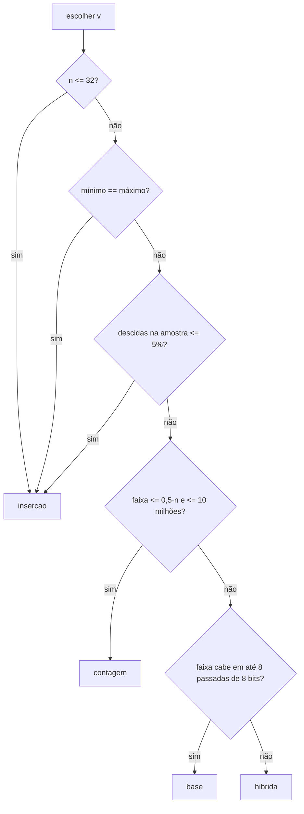

# Projeto_G2_EDA

## Visão geral

Nenhum método de ordenação ganha sempre. A inserção é imbatível em listas quase ordenadas, a contagem domina quando os valores estão numa faixa estreita, a ordenação por base (radix) vence em inteiros grandes e a híbrida (quicksort + inserção) é a opção de uso geral.

Este projeto implementa **seis métodos de ordenação** e um **escolhedor** (`escolher`) que olha rapidamente para a lista (tamanho, mínimo/máximo e uma amostra de pares adjacentes) e decide qual método usar. A função `ordenar` junta as duas coisas: escolhe e ordena.

Uma série de medições compara cada método, em quatro cenários, com a decisão do escolhedor. O objetivo é mostrar que o `ordenar` fica sempre perto do melhor método de cada cenário, enquanto cada método isolado tem pelo menos um cenário em que vai muito mal.

## Estrutura do projeto

```
Projeto_G2_EDA/
├── Metodos/
│   ├── Base.py                      # radix sort LSD (base 256)
│   ├── Contagem.py                  # counting sort
│   ├── Hibrida.py                   # quicksort + inserção nas partições pequenas
│   ├── Insercao.py                  # insertion sort
│   ├── Intercalacao.py              # merge sort
│   └── RapidaComPivoAleatorio.py    # quicksort, pivô aleatório, partição em 3 vias
├── Resultados_para_Analise/
│   ├── resultados.csv               # medições brutas (mediana, em segundos)
│   └── tabela.md                    # tabela formatada com o melhor de cada cenário
├── DadosParaMetodos.py              # geradores de dados (sementes fixas)
├── Escolhedor.py                    # escolher(v) e ordenar(v)
├── Medicoes.py                      # medições e calibração
├── Suite_de_testes.py               # testes automatizados (unittest)
├── README.md
└── RELATORIO.md                     # análise completa dos resultados
```

## Métodos implementados

| Método | Arquivo | Complexidade | Observação |
|---|---|---|---|
| Inserção | `Insercao.py` | O(n + inversões); pior caso O(n²) | Ótima para listas minúsculas ou quase ordenadas |
| Intercalação (merge sort) | `Intercalacao.py` | O(n log n) | Estável; usa memória extra O(n) |
| Rápida (quicksort) | `RapidaComPivoAleatorio.py` | O(n log n) esperado | Pivô aleatório, partição em 3 vias (`<`, `==`, `>`) e pilha O(log n) |
| Híbrida | `Hibrida.py` | O(n log n) esperado | Rápida que usa inserção em partições com até 24 elementos |
| Contagem | `Contagem.py` | O(n + k), k = faixa de valores | Recusa faixas acima de 10 milhões (`MemoryError`) |
| Base (radix LSD) | `Base.py` | O(d · (n + 256)), d = bytes da faixa | Base 256; aceita negativos deslocando pelo mínimo |

Todos os métodos recebem uma lista e **devolvem uma nova lista ordenada**, sem alterar a entrada.

## Requisitos e instalação

- Python 3.12 (versão com a qual o projeto foi desenvolvido e testado).
- Nenhuma dependência externa: só biblioteca padrão (`random`, `unittest`, `multiprocessing`, `csv`, `statistics`, `time`).

```bash
git clone https://github.com/Yarafr/Projeto_G2_EDA.git
cd Projeto_G2_EDA
code .
```

## Como usar

Rode os comandos a partir da raiz do projeto.

```python
from Escolhedor import ordenar, escolher, METODOS

v = [5, 3, 9, 1, 7]

print(escolher(v))        # nome do método escolhido, ex.: "insercao"
print(ordenar(v))         # [1, 3, 5, 7, 9]  (v não é modificada)

# chamando um método específico
print(METODOS["base"]([170, 45, 75, 90, 802, 24, 2, 66]))
```

Os nomes válidos em `METODOS` são `insercao`, `intercalacao`, `rapida`, `hibrida`, `contagem` e `base`.

## Como o escolhedor decide (resumo)

O escolhedor só usa operações baratas: `len`, `min`/`max` nativos e a amostragem de cerca de 1000 pares adjacentes. Ele nunca ordena nem percorre a lista inteira em laço Python.



| Constante | Valor | Significado |
|---|---|---|
| `LIMITE_MINUSCULA` | 32 | até esse tamanho, usa inserção |
| `AMOSTRA` | 1000 | número de pares adjacentes examinados |
| `FRACAO_QUASE` | 0,05 | fração máxima de descidas para considerar "quase ordenada" |
| `FATOR_FAIXA` | 0,5 | contagem só se faixa ≤ 0,5 · n |
| `PASSADAS_MAX_BASE` | 8 | base 256 com até 8 passadas (64 bits) |

Os limites vêm do experimento `python Medicoes.py --calibrar`. A justificativa está no `RELATORIO.md`.

## Como rodar os testes

```bash
python Suite_de_testes.py
# ou
python -m unittest -v Suite_de_testes
```

Os 6 testes cobrem:

- casos de borda em **cada** método (lista vazia, um elemento, todos iguais, já ordenada, invertida, negativos, listas grandes);
- verificação de que a entrada não é alterada;
- 30 listas aleatórias variadas passando por `ordenar`;
- as regras do escolhedor (minúscula, ordenada, iguais, faixa estreita, 4 passadas, chaves enormes);
- recusa da contagem diante de faixas gigantes.

## Como refazer as medições

```bash
python Medicoes.py               
python Medicoes.py --extras      
python Medicoes.py --rapido      
python Medicoes.py --calibrar    
```

Opções: `--reps N` (repetições, padrão 5; usa a mediana) e `--timeout S` (limite por método, padrão 120 s).

Cada método roda em um processo separado com limite de tempo. Métodos quadráticos em listas grandes aparecem como `timeout` em vez de travar a medição, e a contagem aparece como `inviavel` quando a faixa estoura o teto de memória. As cópias das listas são feitas fora do cronômetro e as sementes são fixas (`SEMENTE = 42`), então os dados são sempre os mesmos.

Saídas em `Resultados_para_Analise/`: `resultados.csv` e `tabela.md`.

## Resultados

Tempo em segundos (mediana de 5 execuções). Em negrito, o melhor método de cada cenário.

| cenário | insercao | intercalacao | rapida | hibrida | contagem | base | **ordenar** | melhor | escolheu |
|---|---|---|---|---|---|---|---|---|---|
| aleatorio_grande (n=100 mil, até 10¹²) | timeout | 0,2967 | 0,3677 | 0,2916 | inviável | **0,0841** | 0,0910 | base | base |
| faixa_estreita (n=1 milhão, 0..100) | timeout | 4,9410 | 0,8566 | 0,9782 | **0,1247** | 0,2407 | 0,1453 | contagem | contagem |
| quase_ordenado (n=200 mil, 1% de trocas locais) | **0,0241** | 0,3393 | 0,5850 | 0,5374 | 0,0631 | 0,0926 | 0,0296 | insercao | insercao |
| minuscula (5000 listas de 20) | 0,0508 | 0,1071 | 0,0948 | **0,0494** | 0,2047 | 0,2749 | 0,0496 | hibrida | insercao |

Nos quatro cenários do trabalho, o `ordenar` ficou entre **1,00x e 1,23x** do melhor método. Já cada método isolado teve um cenário ruim: a intercalação chegou a 39,6x do melhor, a rápida a 24,3x, a híbrida a 22,3x, e a inserção e a contagem não terminaram (timeout e inviável).

Os cenários extras mostram onde o escolhedor erra: duas corridas intercaladas (`ordenar` 1520x pior que o melhor) e trocas entre posições distantes (47x pior). A análise completa, a calibração e as limitações estão no "RELATORIO.md".

## Autora (Trabalho feito individualmente)

### Yara Fernandes Ribeiro